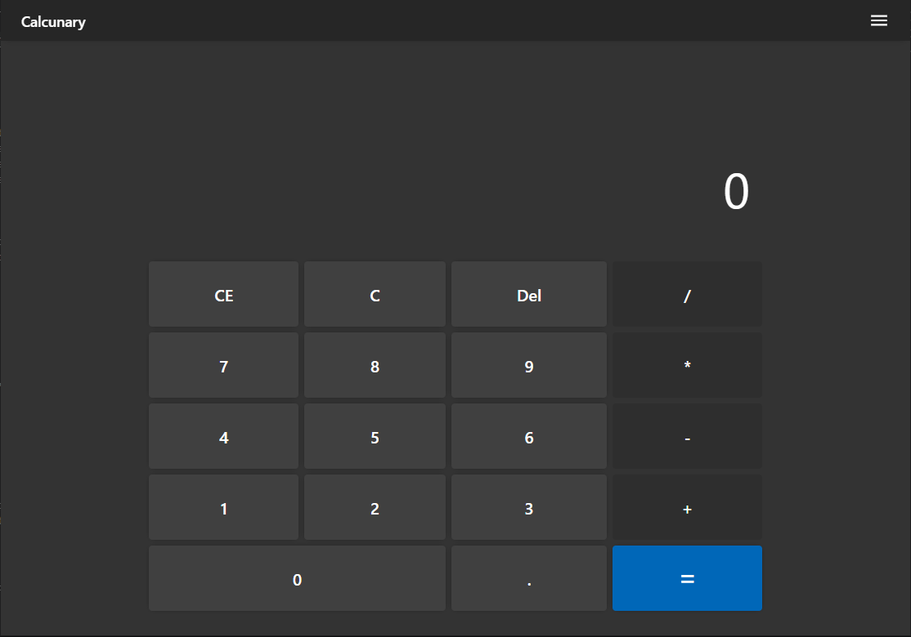

# Calcunary

Calcunary is a modern, responsive, and fully functional web calculator built with ReactJS and CSS.
It provides standard arithmetic operations together with useful converters paired with a robust
modular state machine, high percentage level of result accuracy (96%), and precise error-handling boundaries.



## Highlights & Core Features

- **Chain Calculations:** Fully supports consecutive multi-step calculations (e.g., `10 + 5 × 2 – 3`) without breaking execution flow.
- **Digits Limit:** Supports up to _16_ digits for high-value operations with an auto horizontal scrolling to prevent digits clipping.
- **Error Handling:** Try something intentionally like (e.g, `5 / 0`).
- **Keyboard Shortcuts:** Maps physical keys seamlessly to calculator actions while safely intercepting unwanted browser default shortcuts.
- **Theme Toggler:** A button control in the menu lets users choose between `System`, `Light`, or `Dark` theme. The preference is automatically persisted in `localStorage`.
- **About Info:** Includes an accessible center floated panel from the menu featuring a quick about info.

**Tip:** The theme toggle button shows the icon of the next theme that will be toggled when `hover`, so the title text.

## New Features & Architecture Updates

- **ReactJS:** The App is completely now running on react for better UX, code maintainance and usability.
- **Lighter Operating:** The method of how this app handles inputs and process them form A-Z is completely different from the previos version, resulting in a much fast and lighter operation.
- **Converters:** Now currency option converter is available in the menu but not still under development 🚧, the app will soon start offering various calculators and converters as soon as the development is complete.

## Keyboard Shortcuts and Controls

| Key                | Assigned Action                       |
| :----------------- | :------------------------------------ |
| `0-9`              | Input Digits                          |
| `.`                | Decimal Point                         |
| `+`, `-`, `*`, `/` | Basic Operations (`+`, `-`, `×`, `÷`) |
| `X`                | Delete all numbers in display (`CE`)  |
| `C`                | Reset (`All Clear`)                   |
| `Backspace`        | Delete last entered digit             |
| `Enter`            | Solve / Evaluate Equation             |

## Technologies

- **React 19:** Modern react with reusable components and hooks.
- **JavaScript (ES6):** Logics and Calculations with ES Modules.
- **React Router**: Client-side routing/navigation.
- **CSS3:** Featuring Grid and custom property CSS variables.
- **Vite:** Development server.

## Steps to Run

[Open on Website](https://dawud-shuaibu.github.io/calcunary/)

1. Clone the repository:

   ```bash
   git clone "https://github.com/Dawud-Shuaibu/calcunary.git"
   ```

2. Install or download the dependencies:

   ```bash
   npm install
   ```

3. Run the development server:

   ```bash
   npm run dev
   ```

4. Open your browser and navigate to the provided link from the terminal response (usually `https://localhost:5173`) and explore!.

---

### Contributing

Contributions are welcome! Either you are looking to fix any issues, bug or add features.

### License

This project is open-source software licensed under the MIT License.
